# Repositor de Mídia|deepin-movie|

## Visão geral

O Repositor de Mídia é um software de reprodução de vídeo com interface simples e desempenho fluido. Ele é compatível com diversos formatos de vídeo e oferece suporte à reprodução de vídeos locais ou de arquivos de streaming, à busca de legendas on-line e ao carregamento manual de legendas.

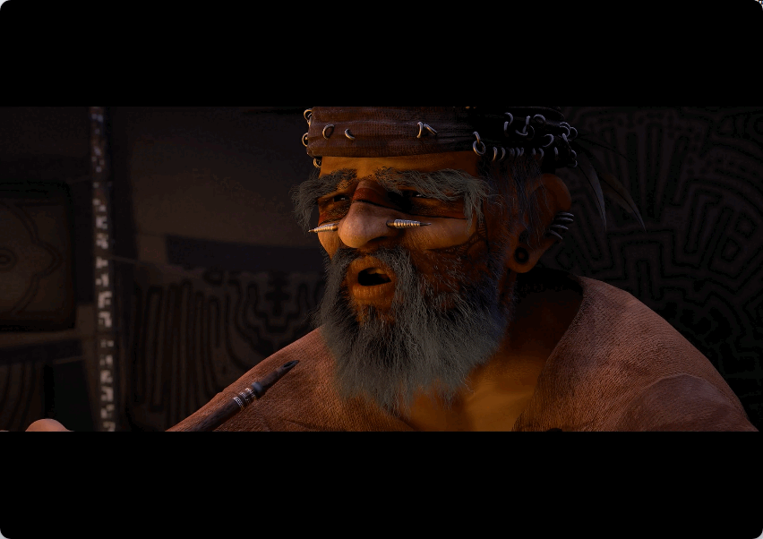

## Introdução

### Executar o Repositor de Mídia

1. Clique no ícone do iniciador  na barra de tarefas para abrir a interface do iniciador.
2. Role a roda do mouse para cima ou para baixo ou use a pesquisa para localizar o ícone do Repositor de Mídia  e clique nele para executar.
3. Clique com o botão direito em  para:
 - Clique em **Enviar para a área de trabalho** para criar um atalho na área de trabalho.
 - Clique em **Enviar para a barra de tarefas** para fixar o aplicativo na barra de tarefas.
 - Clique em **Iniciar automaticamente ao ligar** para adicionar o aplicativo aos itens de inicialização, de modo que ele seja executado automaticamente ao ligar o computador.

### Fechar o Repositor de Mídia
- Na interface do Repositor de Mídia, clique em  para sair do Repositor de Mídia.
- Na barra de tarefas, clique com o botão direito em  e selecione **Fechar tudo** para sair do Repositor de Mídia.
- Na interface do Repositor de Mídia, clique em  e selecione **Sair** para sair do Repositor de Mídia.

### Ver atalhos

Na interface do Repositor de Mídia, use o atalho **Ctrl + Shift + ?** para abrir a interface de visualização de atalhos. Usar os atalhos com familiaridade aumentará bastante a sua eficiência de operação.

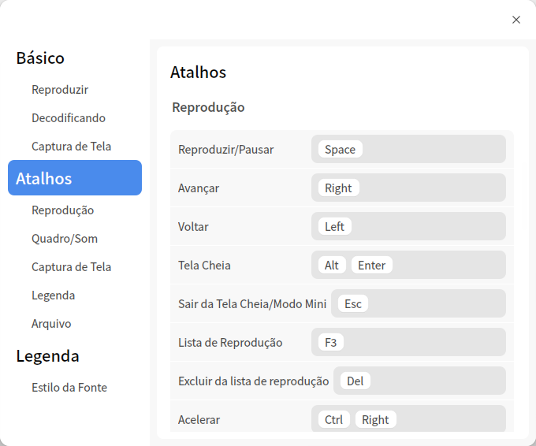

## Interface principal

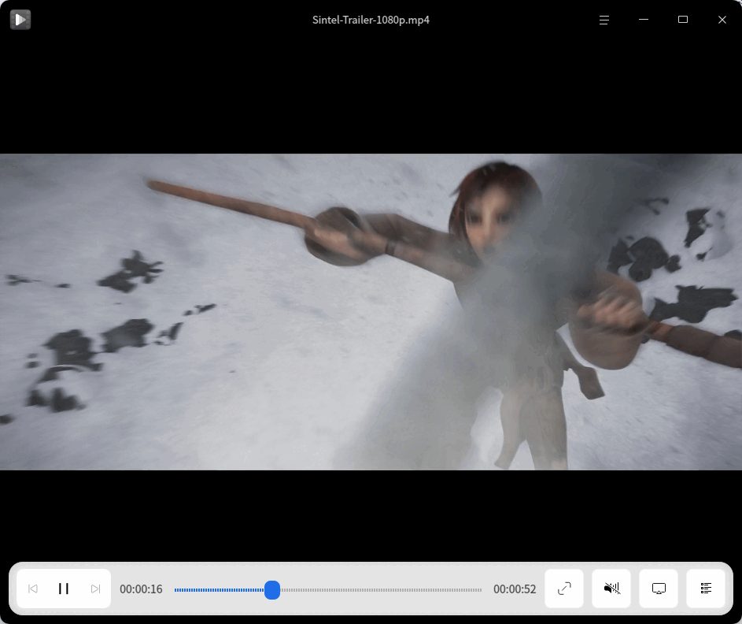

| Nº | Nome | Descrição |
| ---- | -------- | ------------------------------------------------------------ |
| 1 | Janela de reprodução | Exibe o conteúdo do vídeo. Quando o ponteiro do mouse entra na janela de reprodução, a barra de título e a barra de ferramentas são exibidas; quando o ponteiro sai da janela de reprodução ou não há operação, elas são ocultadas. A janela de reprodução não possui moldura, portanto você pode arrastá-la livremente e ajustar o tamanho da janela manualmente. |
| 2 | Exibição de tempo | Exibe a duração total do vídeo em reprodução e as informações do tempo já reproduzido. |
| 3 | Janela de visualização | Exibe o conteúdo do vídeo, permitindo visualizar o conteúdo de um determinado momento por meio da janela de visualização. |
| 4 | Barra de progresso | Exibe o progresso da reprodução de vídeo; arraste a barra de progresso para alterar o progresso. Ao posicionar o ponteiro do mouse sobre a barra de progresso, a janela de visualização de vídeo é exibida. |
| 5 | Barra de título | Exibe o nome do vídeo em reprodução. |
| 6 | Menu principal | Por meio do menu principal, é possível adicionar vídeos, configurar a reprodução, alternar o tema da janela, consultar o manual de ajuda e ver as informações de versão. |

>  Observação: quando o mouse é posicionado sobre a barra de progresso, a janela de visualização é exibida por padrão. Para desativar a janela de visualização, desmarque **Exibir visualização ao passar o mouse sobre a barra de progresso** nas configurações.

### Introdução à barra de ferramentas

| Ícone                                                       | Nome              | Ícone                                                      | Nome           |
| ---------------------------------------------------------- | ----------------- | --------------------------------------------------------- | -------------- |
|      | Reproduzir o vídeo anterior    |     | Reproduzir o próximo vídeo |
|      | Iniciar a reprodução do vídeo      |  | Pausar a reprodução do vídeo   |
|   | Reproduzir em tela cheia          |  |  Sair da tela cheia      |
|   | Ajustar o volume       ||Exibir/ocultar a lista de reprodução|
|  | Transmitir para outros dispositivos |||

## Operações

No Repositor de Mídia, você pode adicionar e excluir vídeos, ver informações e realizar outras operações.

>  Observação: as funções disponíveis variam conforme a tecnologia de decodificação utilizada; considere a interface real como referência.

### Adicionar vídeos

Você pode adicionar vídeos das seguintes formas:
- Quando a lista de reprodução não tiver arquivos, clique no botão  para abrir o gerenciador de arquivos e selecionar o arquivo de vídeo.
- Clique com o botão direito ou selecione **Abrir arquivo** em  para abrir o gerenciador de arquivos e selecionar o arquivo de vídeo.
- Clique com o botão direito ou selecione **Abrir pasta** em ; todos os arquivos de áudio e vídeo da pasta serão exibidos na lista de reprodução e reproduzidos em sequência.
- Clique com o botão direito e selecione **Abrir URL** para inserir o endereço de rede do arquivo de vídeo e reproduzir o vídeo.

   >  Atenção: ao usar o Repositor de Mídia para reproduzir arquivos de vídeo da rede, verifique se o computador está conectado à internet.

- Clique com o botão direito e selecione **Abrir CD/DVD** para reproduzir o vídeo do disco.
- Arraste arquivos ou pastas diretamente para a interface do Repositor de Mídia para adicionar vídeos locais.
>  Observação: em computadores com tela sensível ao toque, mantenha um dedo pressionado sobre o arquivo de vídeo e arraste-o para a interface do Repositor de Mídia para reproduzi-lo.

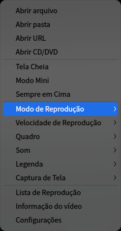

### Avançar/Retroceder

- Na interface do Repositor de Mídia, arraste a barra de progresso com o mouse para avançar ou retroceder o vídeo.
- Na interface do Repositor de Mídia, pressione  no teclado para avançar o vídeo ou  para retroceder o vídeo.
> Observação: em computadores com tela sensível ao toque, no estado de tela cheia, deslize um dedo para a esquerda para retroceder o vídeo e para a direita para avançar o vídeo.

### Ajustar a janela de reprodução

Durante a reprodução do vídeo, você pode ajustar o tamanho da janela de reprodução de forma flexível.

Na interface do Repositor de Mídia, clique com o botão direito:
- Selecione **Tela Cheia** para ajustar a janela do Repositor de Mídia para tela cheia.
- Selecione **Modo Mini** para ajustar a janela do Repositor de Mídia para o modo mini.
- Selecione **Sempre em Cima** para manter a janela do Repositor de Mídia na frente, sem que ela seja coberta por outras janelas durante a operação.
- Você também pode arrastar a borda da janela com o mouse para ajustar o tamanho livremente.

> Observação: clique duas vezes na janela do Repositor de Mídia para alternar entre tela cheia e janela normal.

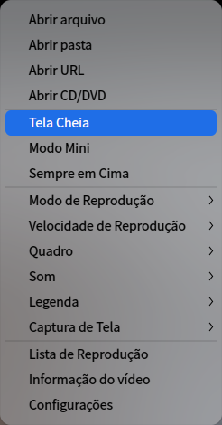

### Ajustar o modo de reprodução

1. Na interface do Repositor de Mídia, clique com o botão direito.
2. Selecione **Modo de Reprodução** e, no menu suspenso:
 - Selecione **Ordem de reprodução** para reproduzir os vídeos na ordem da lista de reprodução, parando quando o último vídeo da lista terminar.
 - Selecione **Reproduzir aleatoriamente** para reproduzir os vídeos da lista de forma aleatória; após reproduzir todos uma vez, a reprodução aleatória continua em ciclo.
 - Selecione **Reproduzir uma vez** para parar após concluir a reprodução do vídeo atual.
 - Selecione **Repetir uma vez** para reproduzir o vídeo atual em ciclo.
 - Selecione **Repetir lista** para reproduzir os vídeos na ordem da lista de reprodução e, ao final do último vídeo, reiniciar a partir do primeiro.

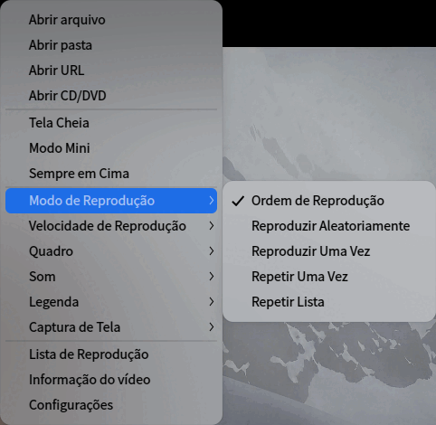

### Ajustar a velocidade de reprodução

1. Na interface do Repositor de Mídia, clique com o botão direito.
2. Selecione **Velocidade de Reprodução** e escolha a velocidade no menu suspenso.

> Dica: você também pode usar atalhos para ajustar a velocidade. Acelerar/desacelerar a reprodução é relativo à velocidade original; a cada aceleração/desaceleração, a velocidade de reprodução aumenta/diminui 0,1 vez por padrão. A velocidade máxima é 2 vezes a velocidade original e a mínima é 0,1 vez a velocidade original.
> - Pressione **Ctrl** +  no teclado para acelerar a reprodução do vídeo.
> - Pressione **Ctrl** +  no teclado para desacelerar a reprodução do vídeo.
> - Pressione  no teclado para restaurar a velocidade original.

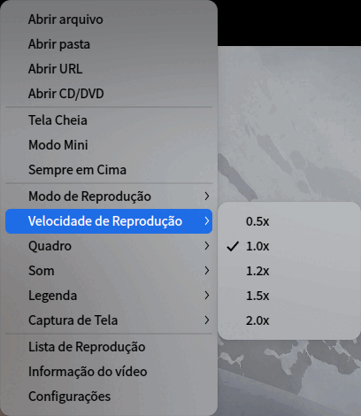

### Ajustar imagem

1. Na interface do Repositor de Mídia, clique com o botão direito.
2. Selecione **Quadro** e, no menu suspenso:
 - Selecione a proporção da imagem para ajustar a exibição para a proporção correspondente.
 - Selecione o modo de rotação para girar a imagem no sentido horário ou anti-horário.
 - Selecione o quadro anterior/o próximo quadro.

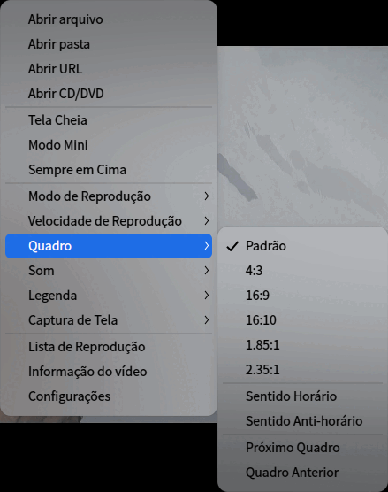

### Ajustar som

1. Na interface do Repositor de Mídia, clique com o botão direito.
2. Selecione **Ajustar som** e, no menu suspenso:
 - Selecione **Canal** para escolher o canal de reprodução do vídeo.
 - Selecione **Faixa** para escolher a faixa de áudio da reprodução do vídeo.

>  Observação: em computadores com tela sensível ao toque, no estado de tela cheia, deslize um dedo para cima na área da imagem do vídeo para aumentar o volume e para baixo para diminuir o volume.

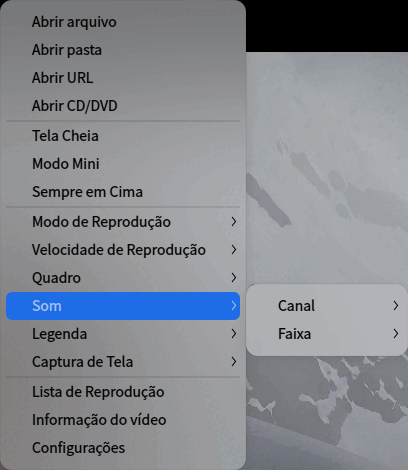

### Ajustar legendas

1. Na interface do Repositor de Mídia, clique com o botão direito.
2. Selecione **Legenda** e, no menu suspenso:
 - Selecione **Carregar** para escolher manualmente um arquivo de legenda e adicioná-lo ao vídeo.
 - Selecione **Pesquisar On-line** para que o Repositor de Mídia procure legendas on-line e as carregue automaticamente após encontrar uma correspondência.
 - Selecione **Selecionar** para alternar entre várias legendas.
 - Selecione **Ocultar** para cancelar a exibição da legenda atual.
 - Selecione **Codificações** para alternar a codificação da legenda e resolver casos de exibição incorreta de caracteres.

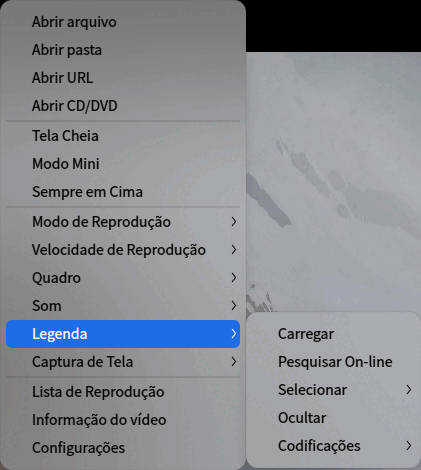

### Captura de Tela

1. Na interface do Repositor de Mídia, clique com o botão direito.
2. Selecione **Captura de Tela** e, no menu suspenso:
 - Selecione **Capturar quadro do vídeo** para capturar a imagem atual.
 - Selecione **Captura sequencial** para capturar imagens de diferentes momentos do vídeo e, ao final, montar uma imagem de pré-visualização da sequência.
 - Selecione **Abrir pasta de capturas** para ver as capturas.

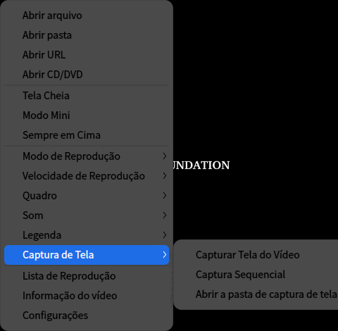

### Ver informações do vídeo

1. Na interface do Repositor de Mídia, clique com o botão direito.
2. Selecione **Informação do vídeo** para ver as informações do vídeo, do codec e do fluxo de áudio.

### Transmitir vídeo

1. Na interface do Repositor de Mídia, clique em .
2. Entre na interface de seleção de dispositivo de transmissão; o sistema pesquisa automaticamente dispositivos compatíveis na mesma rede.
3. Na página de resultados, clique no nome do dispositivo desejado para iniciar a transmissão.
4. Após a transmissão ser iniciada, a interface de transmissão será exibida; clique no botão de sair da transmissão para encerrá-la.

## Gerenciamento da lista

Gerencie os arquivos de vídeo já adicionados na lista de reprodução.

### Excluir arquivo de vídeo

1. Na interface do Repositor de Mídia, clique em .
2. Na janela da lista de reprodução, clique com o botão direito no arquivo de vídeo.
3. Selecione **Remover da lista de reprodução**.

>  Dica: na interface da lista de reprodução, selecione um arquivo de vídeo e clique no botão  para remover o arquivo de vídeo da lista.

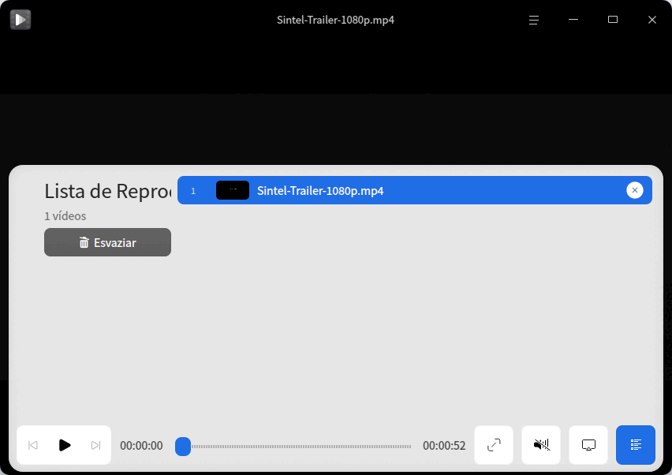

### Limpar lista de reprodução

1. Na interface do Repositor de Mídia, clique em .
2. Na janela da lista de reprodução, clique com o botão direito no arquivo de vídeo.
3. Selecione **Esvaziar a lista de reprodução** ou clique diretamente em **Esvaziar** à esquerda.

### Exibir no gerenciador de arquivos

1. Na interface do Repositor de Mídia, clique em .
2. Na janela da lista de reprodução, clique com o botão direito no arquivo de vídeo.
3. Selecione **Exibir no gerenciador de arquivos** para abrir a pasta onde o vídeo está localizado.

## Menu principal

No menu principal, você pode abrir arquivos/pastas para adicionar vídeos, configurar a reprodução, alternar o tema da janela, consultar o manual de ajuda e conhecer mais sobre o Repositor de Mídia.

### Configurações

Na interface do Repositor de Mídia, clique em  e selecione **Configurações** para ajustar as configurações básicas, os atalhos e as legendas.

#### Configurações básicas

**Configurações de reprodução**

- Marque **Limpar lista de reprodução quando sair** para esvaziar toda a lista de reprodução ao sair do Repositor de Mídia.
- Marque **Lembrar posição de reprodução** para continuar a reprodução do ponto em que o vídeo foi interrompido ao abrir o Repositor de Mídia.
- Marque **Adicionar arquivos semelhantes para reproduzir** para adicionar automaticamente vídeos com nomes semelhantes na mesma pasta à lista de reprodução e reproduzi-los em sequência.
- Marque **Exibir visualização ao passar o mouse sobre a barra de progresso** para exibir a janela de visualização ao passar o mouse sobre a barra de progresso.
- Marque **Exibir miniaturas na barra de progresso** para exibir o estilo de filme ao arrastar a barra de progresso.

   > Observação: apenas a plataforma x86 oferece suporte ao formato de filme.

- Marque **Pausar quando minimizado** para pausar automaticamente a reprodução do vídeo quando o Repositor de Mídia for minimizado.
- Defina o modo padrão de reprodução, que será usado na próxima inicialização do Repositor de Mídia.

**Decodificação**

- **Seleção automática (Recomendado)**: seleciona automaticamente o método de decodificação mais adequado conforme a configuração do dispositivo.
- **Decodificação por hardware**: decodifica o vídeo por hardware.
- **Decodificação por software**: decodifica o vídeo por software.
- **Modo avançado**: decodifica o vídeo por hardware conforme a escolha do usuário.
	- **Mecanismo de renderização**: opção do mecanismo de reprodução interno.
	- **Driver de saída**: driver de saída de vídeo.
	- **Decodificação**: opção do método de decodificação por hardware.

**Captura de Tela**

Define o local de armazenamento das capturas de tela dos vídeos.

#### Configurações de atalhos

Ver os atalhos; permite personalizar os atalhos.

#### Configurações de legendas

Definir o estilo e o tamanho da fonte.

### Tema

O tema da janela inclui tema claro, tema escuro e tema do sistema.

1. Na interface do Repositor de Mídia, clique em .
2. Selecione **Tema** e escolha uma cor de tema.

### Ajuda

Consulte o manual de ajuda para conhecer e usar melhor o Repositor de Mídia.

1. Na interface do Repositor de Mídia, clique em .
2. Selecione **Ajuda**.
3. Consulte o manual de ajuda do Repositor de Mídia.

### Sobre

1. Na interface do Repositor de Mídia, clique em .
2. Selecione **Sobre**.
3. Ver a versão e a apresentação do Repositor de Mídia.

### Sair

1. Na interface do Repositor de Mídia, clique em .
2. Selecione **Sair**.
